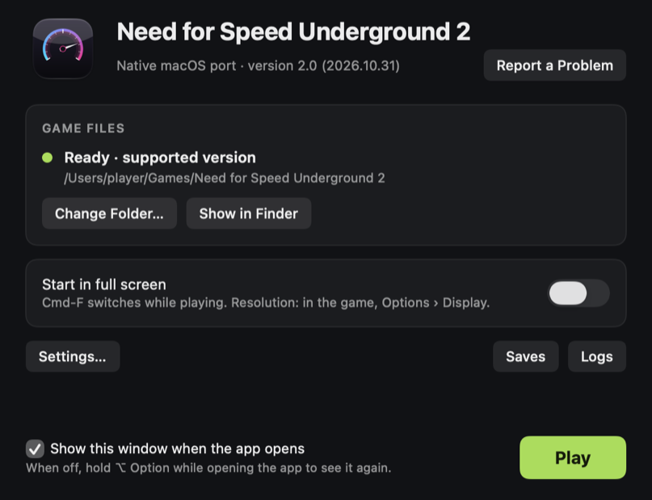

https://github.com/user-attachments/assets/f58f98bd-ca90-48fa-9a7d-5d056cf0cbbb

# Need for Speed: Underground 2 on Mac — native Apple Silicon port, no Wine

**Play *Need for Speed: Underground 2* (NFSU2, 2004) natively on Apple Silicon
Macs (M1 and later): no Wine, no CrossOver, no emulator, no virtual machine.**

NFSU2Recomp is a static recompiler and runtime that turn the original Windows PC
executable of the game (`SPEED2.EXE`, 32-bit x86, Direct3D 9) into a **native
ARM64 macOS app**. The game's x86 machine code is lifted to C ahead of time and
compiled with clang; Direct3D 9 is translated to Metal, DirectSound to
CoreAudio. There is no Wine, no emulator, no JIT and no Windows involved at run
time. On an M1 Pro, races run at **119 fps** (the display's limit), against
**10–15 fps** for the same game under upstream Wine 11; CrossOver and Parallels
have not been measured yet (see [Performance](#performance)).

> **This repository contains no game code and no game assets.** It contains the
> recompiler and the runtime only. You need your own copy of the game. The C
> code generated from its executable is never committed. The prebuilt app on
> the [Releases page](https://github.com/TalhaMudo/NFSU2Recomp/releases/latest) contains the recompiled program but no game files:
> on first launch you point it at your own installation.


## Status

The game boots, reaches the menus, and races are playable with sound.

| Area | State |
|---|---|
| x86-32 → C lifter (integer, x87, MMX, SSE/SSE2, 3DNow!, string ops) | 23,278 functions, 137 MB of generated C |
| Win32 layer (CRT startup, heap, TLS, threads, files, registry, window) | working |
| Direct3D 9 → Metal, shader bytecode (vs/ps 1.x–2.x) → MSL | working |
| DirectSound → CoreAudio, DirectInput (keyboard, mouse, game controllers) | working |
| Videos (intro and story movies, decoded by the game itself) | working |
| Windowed, fullscreen, Retina-native and 1080p widescreen | working |
| Career mode: profile creation (name entry), save and load | working |
| Double-clickable `.app` with a launcher window (`./pack.sh`) | working |
| Optional "HD" build: MSAA (2× at 1440 lines and above, 4× below), SSR, ray-traced reflections | working, see `docs/graphics.md` |

### Known limitations

- **Two builds of `SPEED2.EXE` are supported**, the European and the North
  American v1.2 ones (see [Game versions](#game-versions)); each has its own
  engine. Other builds would need their own lifting pass and address map.
- Keyboard, mouse and game controllers (Xbox / PlayStation / Switch / MFi, and
  DirectInput-mode USB or Bluetooth pads such as 8BitDo's D-input mode); no wheel
  support. No network play.
- Structured exception handling is not implemented (`RtlUnwind` /
  `RaiseException` are stubs).
- x87 is modelled with 64-bit doubles, not 80-bit extended precision.
- One workaround with an unknown root cause remains: the front end's
  world-view-projection matrix arrives broken and an identity matrix is injected
  instead (`FIXMAT`, see `run.sh`).
- About 310 instructions in rarely used opcodes (many of them data the
  disassembler mistook for code) are still emitted as traps. None are hit in the
  measured race scene.
- Some visuals are unverified against a Windows reference (crowds / skinned
  meshes). See "Remaining graphics items" in `docs/devlog.md`.

## How it works

```
SPEED2.EXE (PE32, x86)
   │  tools/lifter/reloc2.py     recover the relocation table  → out/relocs.txt
   │  tools/lifter/genall.py     recursive-descent discovery + tools/lifter/lift.py
   ▼                      x86 → C, one C function per guest function
gen/all/shard_*.c  (128 files) + fntab.c (guest address → native function)
   │  build.sh            clang -O3, in parallel
   ▼
runtime/  (hand-written)  CPU state, guest memory, Win32, D3D9→Metal, audio
   │  link.sh
   ▼
out/nfsu2_boot            ~35 MB arm64 Mach-O
```

- **Pointers vs. constants.** The hard problem of x86 static recompilation is
  telling a 4-byte address from a 4-byte number. This executable has its
  relocation *directory entry* zeroed, but the relocation *data* is still
  physically present in an unnamed section. `tools/lifter/reloc2.py` parses it by hand:
  91,106 absolute addresses, all of which point into the image. Function
  discovery and jump-table recovery are seeded from it.
- **Guest memory.** The 32-bit guest address space is reserved with `mmap`;
  guest→host translation is a single ARM64 addressing mode
  (`ldr w8, [x_base, w_addr, uxtw]`).
- **Indirect calls** go through an O(1) table indexed by guest address.
- **Code generated at run time.** The game writes small x86 thunks to its stack
  and calls them. `runtime/genexec.c` detects these and runs them in a small
  interpreter, handing calls back to lifted functions.
- **D3DX effects.** The statically linked D3DX9 effect framework took ~47% of
  guest time when executed as lifted code; `runtime/d3dx_hle.c` short-circuits
  parts of it (`docs/d3dx-hle.md`).

| Path | What it is |
|---|---|
| `tools/lifter/lift.py` | x86-32 → C lifter, with lazy EFLAGS (flag liveness) |
| `tools/lifter/genall.py` | function discovery, parallel generation, sharding |
| `tools/lifter/reloc2.py` | relocation table recovery |
| `tools/lifter/argcount.py` | stdcall argument counts for imports |
| `tools/verify/isatest.py`, `tools/verify/fuzzisa.py` | instruction-semantics tests and differential fuzzer |
| `runtime/cpu.h`, `mem.c`, `dispatch.c`, `genexec.c` | CPU state, guest memory, dispatch, run-time code |
| `runtime/win32.c`, `win32_ext.c`, `fileio.c`, `res.c` | Win32 API layer |
| `runtime/com.c`, `metal.m`, `vsemu.c` | Direct3D 9 / DirectInput / DirectSound COM layer, Metal renderer, shader translation |
| `runtime/audio.m` | CoreAudio output |
| `runtime/overrides.c`, `d3dx_hle.c` | hand-written replacements for specific game functions |
| `runtime/enhance.c` | HD build only (`-DNFS_ENHANCED=1`) |
| `runtime/bundle.m`, `pack.sh` | `.app` behaviour and packaging |
| `launcher/*.swift` | the app's launcher window (Swift/SwiftUI): finds and checks the game, Original/HD, portable copy, mods |
| `runtime/boot.c` | program entry point (runs the game from its PE entry point) |

## Verification

- **Instruction semantics:** 184 hand-written tests, 474 checks
  (`tools/verify/isatest.py` → `out/isatest`).
- **Differential fuzzing against two independent translators:**
  `tools/verify/fuzzisa.py` assembles random instruction sequences and runs the
  same bytes as lifted C on ARM64, as x86-64 code under Rosetta 2, and in
  Unicorn (QEMU's translator) in 32-bit mode, then compares registers, flags
  and memory. Neither oracle is a CPU; the fuzzer can export its oracle program
  for a run on x86 hardware, which has not been done yet. In a 20,000-case run
  the 145 original templates show no difference against Rosetta; 47 templates
  added later found five lifter defects (four in instruction forms the port
  does not execute; the fifth, `stmxcsr` storing 0, occurs four times in the
  game and is open) and one instruction, `cmpxchg`, where the lifter had copied
  Rosetta's flag behaviour, which differs from the Intel manual.
  `docs/verification-coverage.md` has the details and the coverage: 89% of the
  game's instructions belong to mnemonics compared against at least one
  oracle, 75% against both; the rest is almost entirely `call`/`jmp`/`ret`.
- **Function-level tests:** 15 checks against lifted game functions
  (`out/nfsu2_all`).
- **Reproducible generation:** the generated C is a pure function of the
  executable and the tools; regenerating gives byte-identical output.

`./run.sh test` runs the first and third.

- **Integrity run:** `tools/verify/check.sh` plays both builds invisibly and silently
  from the menus into a Quick Race (~1.5 min each) and checks the end-of-run
  report: no unsupported instructions, no unresolved indirect calls, no broken
  matrices, no GPU command buffer errors, no missing mip levels, the race was
  actually reached, and in the HD build that ray tracing and the separate
  G-buffer pass ran.  Settings are restored and saves go to a temporary folder.

## Performance

Measured on an M1 Pro at 1280×960, same scene and settings, alternating runs:

| | This port | Wine 11.18 (wined3d, Rosetta 2) |
|---|---|---|
| Race | 119 fps (capped by the 120 Hz display) | 10–15 fps |
| 3D menus | 119 fps | 45 fps |
| CPU time per frame | ~12.6 ms | ~105 ms |

This is upstream Wine, measured in windowed mode, and it launched reliably only
4 times out of 11. It is the same graphics path every Wine-based tool uses for
this game (Direct3D 9 goes through wined3d; D3DMetal, DXMT and CrossOver's DXVK
cover Direct3D 10–12 only), but CrossOver's own build and a virtual machine
(Parallels with Windows 11 on Arm) have not been measured, so read the ratio as
"against upstream Wine", not "against the best alternative".
`docs/wine-comparison.md` lists what a proper baseline still needs.

Power while racing at the display's native resolution (3024×1964, 120 fps,
M1 Pro, `powermetrics`, a real play session): the standard build draws about
**6.5 W** for CPU + GPU, stays at or below 70 °C and never spins the fans; the
HD build draws about 18 W.

## Requirements

- Apple Silicon Mac, macOS 11 or later. Developed on an M1 Pro, macOS 27.
- Xcode Command Line Tools (`clang`; `swiftc` for the launcher window).
- Python 3 with `capstone` 5.x and `pefile` (`requirements.txt`).
- Rosetta 2, only for `tools/verify/fuzzisa.py`; optionally `unicorn` 2.x for
  its second oracle.
- Your own installation of the game, with one of these executables (both v1.2
  without the CD check, built Feb 9 2005):

  | Build | `SPEED2.EXE` size | SHA-256 |
  |---|---|---|
  | **European** (PAL) v1.2 | 4,788,224 bytes | `8f6a9ae2c4cfa01181d2fd755d99c6f4b7103f60273908ea1de1e719dfe2a297` |
  | **North American** v1.2 | 4,800,512 bytes | `f9dd86c054878ce6276beb07c1fd61874f7a1e4bf1f241b084c65b73e24168a7` |

  The app checks the file at startup, picks the matching engine and says so
  instead of crashing on any other file; `NFSU2_ANY_EXE=1` skips the check.

### Game versions

The recompiled code belongs to one executable, so every build of `SPEED2.EXE`
gets its own lifting pass and engine. The game *data* is a separate matter (see
the note under the table).

| `SPEED2.EXE` | Size | SHA-256 | Status |
|---|---|---|---|
| European v1.2, no CD check | 4,788,224 | `8f6a9ae2c4cfa01181d2fd755d99c6f4b7103f60273908ea1de1e719dfe2a297` | **Supported** (the reference build) |
| North American v1.2, no CD check (the build most PC mods target) | 4,800,512 | `f9dd86c054878ce6276beb07c1fd61874f7a1e4bf1f241b084c65b73e24168a7` | **Supported** (engines `nfsu2-engine-na`, `-na-hd`). Tested on US disc data from the menus into a Quick Race, original and HD. |
| US v1.0 retail disc | 5,987,981 | `2cbd698fee8338a13d1891bc17d27e6641b4b9dd40580de818594b9140222899` | **Cannot be supported.** Protected by SafeDisc: the code section is encrypted on disc and only decrypted at run time, so there is nothing to recompile. |

The retail disc executable carries the disc's copy protection, and the official
v1.2 patch most likely keeps it (not verified here). A static recompiler needs
readable machine code, so the port cannot use a protected executable, and this
project does not remove copy protection.

**Data from the discs.** The US discs and the European release share 1,218 of
their ~1,250 files byte for byte. The differences are the region's cars (the US
release has `CARS/CIVIC` and `CARS/RSX`; the European one has `CARS/CORSA` and
`CARS/PEUGOT106`), the per-language movies, `FRONTEND/FrontB.lzc` and
`server.dll`.

**US data works with the supported executable.** The game's region is a
constant in the executable (`0` in the US build, `6` in the European one), and
it decides which of the region-only cars exist. Left at the European value, US
data hangs on the "Loading" screen as soon as a race picks a Corsa or a 106. The
runtime therefore looks at the data at startup: if `CARS/CIVIC` and `CARS/RSX`
are there but `CARS/CORSA` and `CARS/PEUGOT106` are not, it switches the game to
the US region (log line `region: North American data`). Tested on US disc data:
races load, the Civic is in the Quick Race car list and the Mazda is called
Miata, as in the US release; the region check hides the Corsa and 106.
`NFSU2_REGION=na` or `eu` forces either region.

### Installing from the PC discs on a Mac

The discs hold the game in plain zip files, so the Windows installer is not
needed. With the two disc images (`.cue`/`.bin`, `.iso`, or the disc folders):

```bash
brew install sevenzip     # only needed for .bin/.iso images
python3 tools/packaging/install_from_discs.py ~/Games/NFSU2 "Disc 1.cue" "Disc 2.cue"
```

This writes a normal game folder (about 1.7 GB) that the launcher can point at.
It copies the disc's `SPEED2.EXE` too, but see the table above: the disc
executable cannot run, so put a supported one in its place. The North American
v1.2 executable is the natural match for US disc data; the European one also
works with it (see "US data works with the supported executable" above).

### How the North American build is made

The European executable is the reference: the runtime was written against it.
`tools/lifter/addrmap.py` matches the two executables function by function (a byte
signature with the parts that move between builds masked, aligned in order) and
collects data-address pairs from the matched code: 23,276 of 23,277 functions
match, most code is 16 bytes away from the European build, most data is at the
same address. Every game address in the runtime is written as `GA(0x…)` in
European terms; for the North American engine `runtime/build_na.h` (generated
from the map) turns each one, and each `sub_XXXXXXXX` name the runtime uses, into
the North American one. An address the map cannot place stops the build.

Two things differ at run time:

- The North American no-CD executable still looks for a CD-ROM drive (its disc
  contents check is patched out, the drive check is not) and otherwise asks for
  "Disc 2" forever. Its engine reports `D:` as an empty CD-ROM drive; paths on
  `D:` resolve to the game folder like those on `C:`.
- Its region variable is in `.bss` (0, the US) rather than a constant, see
  "US data works with the supported executable".

Function discovery missed eight call targets in this executable (its linear scan
stops on bytes an earlier, misaligned scan covered), which became traps;
`LIFT_MISSING=1` (set by `tools/lifter/gen_v2.sh` for this build) lifts such targets in
extra shards.

## Build and run

Run everything from the repository root.

```bash
export NFSU2_DATA="/path/to/Need for Speed Underground 2"   # folder containing SPEED2.EXE
EXE="$NFSU2_DATA/SPEED2.EXE"

python3 -m venv .venv && .venv/bin/pip install -r requirements.txt

# 1) relocation table, cross-function flag liveness, lifting every function
#    to C, import argument table -> gen/all/   (~1 min on an M1 Pro)
#    The script holds the OVERRIDE list (functions that runtime/overrides.c and
#    runtime/d3dx_hle.c replace); it must match them or the link fails.
tools/lifter/gen_v2.sh "$EXE"

# 2) compile the shards, then build the runtime and link   (~1.5 min)
./build.sh && ./link.sh

./run.sh test        # ISA + function tests
./run.sh             # windowed
./run.sh 1080p       # 1920x1080, widescreen-corrected
./run.sh hd          # HD build
./pack.sh            # out/NFSU2.app: launcher + both engines (Original and HD)
./pack.sh --zip      # also out/NFSU2.zip for a release
./pack.sh --embed    # out/personal/NFSU2.app with your game inside (do not share)
```

For the North American v1.2 executable the same steps build a second pair of
engines; `tools/lifter/gen_v2.sh` recognises the file by its SHA-256 and writes `gen/na`,
`run.sh` picks the engine by the executable, and `pack.sh` adds the engines to the
app when they are built:

```bash
tools/lifter/gen_v2.sh "/path/to/NA/SPEED2.EXE"       # -> gen/na
BUILD=na ./build.sh && BUILD=na ./link.sh       # -> out/nfsu2_na_boot, out/nfsu2_na_hd_boot
```

`runtime/build_na.h` is committed. `link.sh` regenerates it from
`out/na/addrmap.json` when that file exists, which takes both executables:
`tools/lifter/addrmap.py build <European SPEED2.EXE> <North American SPEED2.EXE> out/na/addrmap.json`.
Do this after adding a `GA(...)` address or a `sub_` name to the runtime; game
addresses written without `GA(...)` would be wrong in the North American engine.

The app opens a small launcher window first (`launcher/`, built by `pack.sh`
with `swiftc`): it finds and checks `SPEED2.EXE`, offers full screen, opens the
logs folder and manages saves (**Saves…**: the career profiles, backups, ZIP
export and import; the current saves are backed up before an import replaces
them; tests/save_manager.sh). **Settings…** (Cmd-,) holds the options on tabs:
Original or HD graphics and the HUD on **Graphics**; on **Picture**, optional
settings of the HD engine only (the PC version's colour tint, console gamma, edge
smoothing, sharpening; `TINT` / `CONSOLEGAMMA` / `EDGEAA` / `SHARPEN`, all off by
default; the Original engine ignores them) and the reflections' sky, car lights
and detail (`NFSU2_REFLECT_SKY` / `_LIGHTS` / `_DETAIL`, HD engine only too); on
**Controls**, the game
controller on or off, its stick dead zone and the XtendedInput layout
(`NFSU2_PAD` / `NFSU2_PAD_DEADZONE` / `NFSU2_XTINPUT`, which still win when set by
hand); on **More**, **Make Copy…** builds a portable
app with the game files inside (APFS clones, seconds on the same disk), so nobody
needs `pack.sh --embed` or a terminal for that.
On **Mods**, PC mods for the game's data are added from their archive or folder
(**Add Mod…**): mods with a Binary / Binarius install script (`install.end`,
`.endlauncher`), run with Binarius' own libraries, and mods that are plain game
files; **NFSU2 Unlimiter** 4.0.0.802 has its own row with Download (North American
v1.2 game). Each mod has a switch, off by default; the game folder is never
changed: the mods are installed into a clone of it and only the files they change
are kept, in Application Support (`docs/mods.md`).
**Restore Original Game** sets every option back to the original, unmodified
game. Untick "Show this window when the app opens" to go straight into the game
(hold Option to get the window back). `NFSU2_SKIP_LAUNCHER=1` / `NFSU2_ENGINE=original|hd` do the same
from scripts.



`run.sh` documents the environment switches; most are diagnostics.

While playing, **Cmd+Shift+D** writes the next frame as a PNG plus the full
draw list (to `~/Library/Logs/NFSU2/`), for reporting rendering problems.
`tools/perf/session.sh [hd]` records a play session (frame times, CPU/GPU power,
temperature, fan speed, screenshots) and `tools/perf/session_report.py` turns it into
a report.

## FAQ

**Can I play Need for Speed: Underground 2 on a Mac?**
Yes, on an Apple Silicon Mac (M1 or later) with your own copy of the PC game.
Download `NFSU2.zip` from the [Releases page](https://github.com/TalhaMudo/NFSU2Recomp/releases/latest), or build the port as
described above (`./pack.sh` produces a double-clickable `NFSU2.app`). Open it,
choose the game folder once, click Play. Menus, races, career saves and sound
work.

**Do I need Wine, CrossOver, Whisky, Parallels or a virtual machine?**
No. The game's code is recompiled to native ARM64 and runs directly on macOS.
Rosetta 2 is not used to run the game (only, optionally, by one test tool).

**Is it faster than Wine or CrossOver?**
Than upstream Wine, yes: on an M1 Pro at 1280×960, 119 fps in races (capped by
the 120 Hz display) against 10–15 fps under Wine 11.18 with Rosetta 2, and 119
fps against 45 fps in the 3D menus. CrossOver has not been measured. Method,
caveats and raw data are in `docs/wine-comparison.md` and `bench/wine/`.
Unlike Wine and CrossOver, the port does not depend on Rosetta 2, which Apple
is phasing out after macOS 27.

**Is there a ready-made download?**
Yes: the [Releases page](https://github.com/TalhaMudo/NFSU2Recomp/releases/latest) has `NFSU2.zip`. The app holds both
graphics modes, Original and HD (MSAA, ray-traced reflections), chosen in its
Settings; older releases had a separate `NFSU2.HD.zip`. It contains no game files:
the window asks for the folder that holds your own `SPEED2.EXE`.
The app is not notarized, so macOS blocks the first start: open System Settings ›
Privacy & Security and click **Open Anyway** (on macOS 14 and older: right-click
the app › Open). If macOS says the app is damaged, run once in Terminal:
`xattr -dr com.apple.quarantine /Applications/NFSU2.app`

**Can I carry the game to another Mac in one piece?**
Yes. In the app's Settings (More tab), **Make Copy…** creates "NFSU2 Portable.app" with the
game files inside: about 1.4 GB, plus the movies (1.1 GB) and the language packs in `LANGPACKS` if the game folder has them. Untick those when saving it for a smaller copy. It runs on its own; saves stay in
`~/Library/Application Support/NFSU2 Saves` on each Mac. It contains the game,
so keep it for yourself.

**Which version of the game does it need?**
The Windows PC version, with the European or the North American v1.2
`SPEED2.EXE` listed under [Requirements](#requirements). The US v1.0 disc
executable cannot be supported (it is copy-protected). Console versions are not
supported. See [Game versions](#game-versions).

**I only have the PC discs. Can I install them on a Mac?**
Yes, without Windows: `tools/packaging/install_from_discs.py` unpacks the disc images
into a game folder. See [Installing from the PC discs on a
Mac](#installing-from-the-pc-discs-on-a-mac).

**The sound cuts out for a moment every few seconds.**
Fixed after v2.2: the game's two sound loops depend on waking up every 10 ms, and
macOS woke them late or let the game's main thread keep them waiting (see
`docs/devlog.md`, "audio dropouts"). If it still happens, please attach
`~/Library/Logs/NFSU2/nfsu2.log` (`nfsu2-hd.log` for HD) to an issue: its
`[timer]` lines show which part is late.

**Does it work on Intel Macs?**
No. Only Apple Silicon is targeted and tested.

**What does not work yet?**
There is no wheel support and no online play.
See [Known limitations](#known-limitations).

**Can the controller work like it does with the XtendedInput mod on Windows?**
Yes, with the North American v1.2 executable: in **Settings… › Controls**, with the
controller on, switch on **XtendedInput layout**. The triggers are then separate analog throttle (RT) and
brake (LT), and every button, in races and in the menus, does what it does with
[NFSU-XtendedInput](https://github.com/xan1242/NFSU-XtendedInput)
(`runtime/xtinput.c` is a port of its NFSU2 code, MIT licence). The game
folder's `scripts/NFSU_XtendedInput.ini` is used if there is one, as in a Windows
install with the mod; otherwise the mod's stock settings. Without the switch the
pad is a DirectInput gamepad, bound in the game's own controller options.

**My controller works in other apps but not in the game.**
Pads that macOS's GameController framework knows (Xbox, PlayStation, Switch, MFi)
are used directly. Other pads are read as plain HID devices, which covers
DirectInput ("D-input") mode pads: an 8BitDo pad in D-input mode, a Logitech pad
with its switch on D, most generic USB pads. Their buttons are laid out like an
Xbox pad from a built-in list of known controllers (SDL's macOS mappings, e.g. the
8BitDo Ultimate 2C), otherwise from a guess. A pad in X-input mode is not a HID
device on macOS and is not seen at all; switch it to D-input (the pad's manual
gives the button combination or mode switch). If the buttons come out wrong, put a
[SDL GameControllerDB](https://github.com/mdqinc/SDL_GameControllerDB) line for the
pad (the `platform:Mac OS X` one) into `gamecontrollerdb.txt` in the game folder;
the whole file can be used as it is. `NFSU2_PAD_MAP` can name another file or hold
the lines itself, and `NFSU2_PAD_HID=0` turns this off. The engine's log
(`~/Library/Logs/NFSU2/nfsu2.log`) shows which pad was found and the mapping used
(`[pad]` lines).

**How is this different from other NFSU2 projects?**

| Project | Approach | Platforms |
|---|---|---|
| **NFSU2Recomp** (this) | Recompiles the PC executable with its own x86 → C lifter; own Direct3D 9 → Metal renderer | macOS (Apple Silicon) |
| [OpenUG2](https://github.com/whoismept/OpenUG2) | Reimplements the engine from scratch and reads the game's data files; does not run the original code | Linux, macOS, Windows |
| [nfsu2-recompiled](https://github.com/codepdbh/nfsu2-recompiled) | Recompiles the PC executable with pcrecomp; Direct3D 9 through DXVK | Windows, Android |
| [nfsu2-sw](https://github.com/antoxa2584x/nfsu2-sw) | Recompiles the original Xbox version with xboxrecomp | Nintendo Switch, Linux |

## Related work

Static recompilation of x86 is not new, and this is not the first project to do
it:

- [M-HT/SR](https://github.com/M-HT/SR) statically recompiles DOS and Windows
  game executables (Septerra Core, Battle Isle 3 and others) at assembly level,
  for targets including macOS arm64.
- [sp00nznet/xboxrecomp](https://github.com/sp00nznet/xboxrecomp) lifts original
  Xbox (x86) games to C with a Python + Capstone pipeline very similar to this
  one.
- [N64: Recompiled](https://github.com/N64Recomp/N64Recomp) and
  [XenonRecomp](https://github.com/hedge-dev/XenonRecomp) established the
  approach for MIPS and PowerPC consoles, and are where the method here comes
  from.
- McSema, rev.ng, RetDec and BinRec are IR-based binary lifters from the research
  side.

What this project adds is narrower: statically recovering a relocation table
whose directory entry was zeroed and using it to separate pointers from
constants (with it 96% of the code section is decoded, with the usual
"looks like an address" heuristic 86% plus 958 entries that start inside an
instruction; `docs/relocation-ablation.md`); a differential instruction fuzzer
that needs no x86 hardware, using Rosetta 2 and Unicorn as oracles; a hybrid
interpreter for x86 code the game generates at run time; and an end-to-end,
playable Win32 + Direct3D 9 → macOS ARM64 + Metal port of a 23,000-function 3D
game. The closest academic work, and where these claims stop, is in
`docs/literature.md` (§13) and `docs/research-plan.md`.

## Repository layout

```
build.sh link.sh pack.sh run.sh   build, link, package and run (from the repository root)
runtime/            Win32, Direct3D 9 -> Metal, DirectSound -> CoreAudio; boot.c is the entry point
launcher/           the Swift launcher window of the app
tests/              ISA / function test harness, save manager test
tools/lifter/       x86 -> C lifter and the generation pipeline (gen_v2.sh)
tools/analysis/     disassembly, cross-references, coverage, effect-file parsers
tools/verify/       instruction tests, Rosetta differential fuzzer, quick race check
tools/perf/         session recording and reports, run comparison, profiles
tools/packaging/    app icon, sharp-HUD pack, installing from the PC discs
tools/debug/        crash triage (diag.sh)
tools/mods/         Binarius mod installer, NFSU2 Unlimiter build
tools/nfsref/       Windows reference plugin (source only)
docs/               engineering log, design notes, measurements, images
```

## Documentation

- `docs/devlog.md` — chronological engineering log: findings, bugs and root causes,
  measurements.
- `docs/d3dx-hle.md` — high-level emulation of the D3DX effect framework.
- `docs/graphics.md` — graphics research and the HD build.
- `docs/lifter-efficiency.md` — lifter efficiency work and measurements.
- `docs/research-plan.md` — research question, claims and their evidence, the
  experiments done and open, threats to validity.
- `docs/verification-coverage.md` — what the instruction tests cover, the
  oracles' limits, the differences found.
- `docs/relocation-ablation.md` — code discovery with and without the recovered
  relocation table.

## How this was built

Development was carried out with an AI coding assistant (Claude Code) under the
direction of the project owner. Goals, constraints and priorities, observations
from playing the game, Windows reference material and direction decisions came
from the project owner; implementation, measurement and debugging were done
together with the assistant.

## Legal

Copyright (c) 2026 Talha Müderrisoğlu. All rights reserved.

This repository is **not open source**. You may download, build, run and
modify it for your own personal, non-commercial use with your own copy of the
game. Publishing, distributing or sharing it — or any modified version, port,
fork or build of it — and any commercial use require prior written
permission. See `LICENSE`.

**Permission:** to publish, share or build on this code, ask first by opening
an issue in this repository.

**License history:** early versions of this project were published under the
MIT License, and a license change became necessary later. Anyone who obtained
those early versions under the MIT License may keep using them under its
terms; the license above applies to the current version and everything after
it.

This project is not affiliated with or endorsed by Electronic Arts. *Need for
Speed* and *Need for Speed: Underground 2* are trademarks of Electronic Arts
Inc. The repository contains none of the game's code or data. Screenshots show
the game running through this port and are included for documentation; the
game content in them belongs to its owners.
