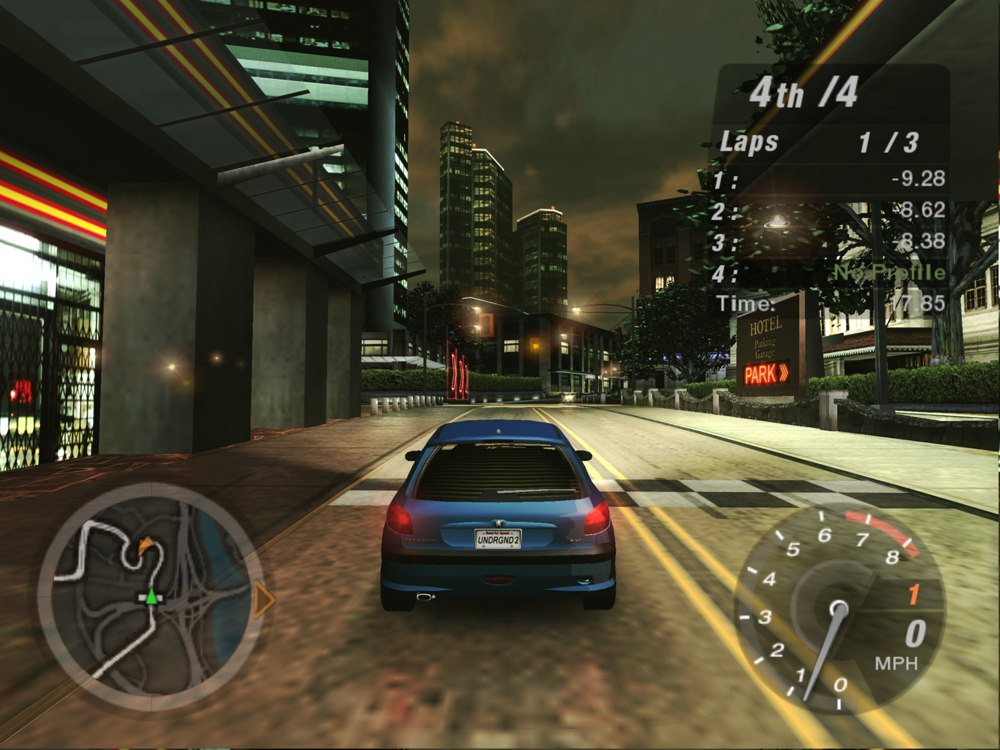

# Need for Speed: Underground 2 on Mac — native Apple Silicon port, no Wine

**Play *Need for Speed: Underground 2* (NFSU2, 2004) natively on Apple Silicon
Macs (M1 and later): no Wine, no CrossOver, no emulator, no virtual machine.**

NFSU2Recomp is a static recompiler and runtime that turn the original Windows PC
executable of the game (`SPEED2.EXE`, 32-bit x86, Direct3D 9) into a **native
ARM64 macOS app**. The game's x86 machine code is lifted to C ahead of time and
compiled with clang; Direct3D 9 is translated to Metal, DirectSound to
CoreAudio. There is no Wine, no emulator, no JIT and no Windows involved at run
time. On an M1 Pro, races run at **119 fps** (the display's limit), against
**10–15 fps** for the same game under Wine.

> **This repository contains no game code and no game assets.** It contains the
> recompiler and the runtime only. You need your own copy of the game; the C
> code generated from its executable and the resulting binaries are derived
> from the game and are not, and must not be, distributed here.



## Status

The game boots, reaches the menus, and races are playable with sound.

| Area | State |
|---|---|
| x86-32 → C lifter (integer, x87, MMX, SSE/SSE2, 3DNow!, string ops) | 23,278 functions, 132.5 MB of generated C |
| Win32 layer (CRT startup, heap, TLS, threads, files, registry, window) | working |
| Direct3D 9 → Metal, shader bytecode (vs/ps 1.x–2.x) → MSL | working |
| DirectSound → CoreAudio, DirectInput (keyboard, mouse) | working |
| Windowed, fullscreen, Retina-native and 1080p widescreen | working |
| Double-clickable `.app` (`./pack.sh`) | working |
| Optional "HD" build: 4× MSAA, SSR, ray-traced reflections | working, see `GRAFIK_ARASTIRMA.md` |

### Known limitations

- **Exactly one build of `SPEED2.EXE` is supported** (see [Requirements](#requirements)).
  Game addresses are hard-coded in the runtime, and the pipeline relies on a
  property of that particular file (below).
- Videos are skipped: there is no VP6 decoder.
- Keyboard and mouse only; no gamepad or wheel support. No network play.
- Structured exception handling is not implemented (`RtlUnwind` /
  `RaiseException` are stubs).
- x87 is modelled with 64-bit doubles, not 80-bit extended precision.
- One workaround with an unknown root cause remains: the front end's
  world-view-projection matrix arrives broken and an identity matrix is injected
  instead (`FIXMAT`, see `run.sh`).
- 400 instructions in rarely used opcodes are still emitted as traps. None are
  hit in the measured race scene.
- Some visuals are unverified against a Windows reference (crowds / skinned
  meshes, HUD seams). See "Kalan grafik maddeleri" in `PROJECT.md`.

## How it works

```
SPEED2.EXE (PE32, x86)
   │  tools/reloc2.py     recover the relocation table  → out/relocs.txt
   │  tools/genall.py     recursive-descent discovery + tools/lift.py
   ▼                      x86 → C, one C function per guest function
gen/all/shard_*.c  (128 files) + fntab.c (guest address → native function)
   │  build.sh            clang -O3, in parallel
   ▼
runtime/  (hand-written)  CPU state, guest memory, Win32, D3D9→Metal, audio
   │  link.sh
   ▼
out/nfsu2_boot            46 MB arm64 Mach-O
```

- **Pointers vs. constants.** The hard problem of x86 static recompilation is
  telling a 4-byte address from a 4-byte number. This executable has its
  relocation *directory entry* zeroed, but the relocation *data* is still
  physically present in an unnamed section. `tools/reloc2.py` parses it by hand:
  91,106 absolute addresses, all of which point into the image. Function
  discovery and jump-table recovery are seeded from it.
- **Guest memory.** The 32-bit guest address space is reserved with `mmap`;
  guest→host translation is a single ARM64 addressing mode
  (`ldr w8, [x_base, w_addr, uxtw]`).
- **Indirect calls** go through an O(1) table indexed by guest address.
- **Code generated at run time.** The game writes small x86 thunks to its stack
  and calls them. `runtime/genexec.c` detects these and runs them in a small
  interpreter, handing calls back to lifted functions.
- **D3DX effects.** The statically linked D3DX9 effect framework took ~47% of
  guest time when executed as lifted code; `runtime/d3dx_hle.c` short-circuits
  parts of it (`D3DX_HLE.md`).

| Path | What it is |
|---|---|
| `tools/lift.py` | x86-32 → C lifter, with lazy EFLAGS (flag liveness) |
| `tools/genall.py` | function discovery, parallel generation, sharding |
| `tools/reloc2.py` | relocation table recovery |
| `tools/argcount.py` | stdcall argument counts for imports |
| `tools/isatest.py`, `tools/fuzzisa.py` | instruction-semantics tests and differential fuzzer |
| `runtime/cpu.h`, `mem.c`, `dispatch.c`, `genexec.c` | CPU state, guest memory, dispatch, run-time code |
| `runtime/win32.c`, `win32_ext.c`, `fileio.c`, `res.c` | Win32 API layer |
| `runtime/com.c`, `metal.m`, `vsemu.c` | Direct3D 9 / DirectInput / DirectSound COM layer, Metal renderer, shader translation |
| `runtime/audio.m` | CoreAudio output |
| `runtime/overrides.c`, `d3dx_hle.c` | hand-written replacements for specific game functions |
| `runtime/enhance.c` | HD build only (`-DNFS_ENHANCED=1`) |
| `runtime/bundle.m`, `pack.sh` | `.app` behaviour and packaging |
| `tests/boot.c` | program entry point (runs the game from its PE entry point) |

## Verification

- **Instruction semantics:** 169 hand-written tests, 439 checks
  (`tools/isatest.py` → `out/isatest`).
- **Differential fuzzing against real x86:** `tools/fuzzisa.py` assembles random
  instruction sequences, runs them as real x86-64 code under Rosetta 2 and as
  lifted C on ARM64, and compares registers, flags and memory.
- **Function-level tests:** 15 checks against lifted game functions
  (`out/nfsu2_all`).
- **Reproducible generation:** the generated C is a pure function of the
  executable and the tools; regenerating gives byte-identical output.

`./run.sh test` runs the first and third.

## Performance

Measured on an M1 Pro at 1280×960, same scene and settings, alternating runs
(method, raw numbers and caveats in `WINE_KIYAS.md`):

| | This port | Wine 11.18 (wined3d, Rosetta 2) |
|---|---|---|
| Race | 119 fps (capped by the 120 Hz display) | 10–15 fps |
| 3D menus | 119 fps | 45 fps |
| CPU time per frame | ~12.6 ms | ~105 ms |

## Requirements

- Apple Silicon Mac, macOS 11 or later. Developed on an M1 Pro, macOS 27.
- Xcode Command Line Tools (`clang`).
- Python 3 with `capstone` 5.x and `pefile` (`requirements.txt`).
- Rosetta 2, only for `tools/fuzzisa.py`.
- Your own installation of the game, with this exact executable:

  | | |
  |---|---|
  | File | `SPEED2.EXE`, 4,788,224 bytes |
  | SHA-256 | `8f6a9ae2c4cfa01181d2fd755d99c6f4b7103f60273908ea1de1e719dfe2a297` |

  Other builds have not been tested and will not work without changes.

## Build and run

Run everything from the repository root.

```bash
export NFSU2_DATA="/path/to/Need for Speed Underground 2"   # folder containing SPEED2.EXE
EXE="$NFSU2_DATA/SPEED2.EXE"

python3 -m venv .venv && .venv/bin/pip install -r requirements.txt

# 1) relocation table -> out/relocs.txt
.venv/bin/python tools/reloc2.py "$EXE"

# 2) lift every function to C -> gen/all/   (~20 s)
#    OVERRIDE lists the functions that runtime/overrides.c and
#    runtime/d3dx_hle.c wrap; it must match them or the link fails.
OVERRIDE=60fab0,61e390,61f130,5c7ed0,50d510,65ae35,6623ea,66aa3f,66ace2,6691b1,669296,664a2f,663a42,688e89,663275,662edc,660a52,668e0d,664792,66ac27,65addb,65acf5,66d13a,66d303,66d7e9,66e8a9,66f501,66ca38,65ab24 \
  .venv/bin/python tools/genall.py "$EXE" 128

# 3) import argument table -> gen/all/impargs.c
.venv/bin/python tools/argcount.py "$EXE"

# 4) compile the shards, then build the runtime and link
./build.sh && ./link.sh

./run.sh test        # ISA + function tests
./run.sh             # windowed
./run.sh 1080p       # 1920x1080, widescreen-corrected
./run.sh hd          # HD build
./pack.sh            # out/NFSU2.app
```

`run.sh` documents the environment switches; most are diagnostics.

## FAQ

**Can I play Need for Speed: Underground 2 on a Mac?**
Yes, on an Apple Silicon Mac (M1 or later) with your own copy of the PC game.
Build the port as described above; `./pack.sh` produces a double-clickable
`NFSU2.app`. Menus, races and sound work.

**Do I need Wine, CrossOver, Whisky, Parallels or a virtual machine?**
No. The game's code is recompiled to native ARM64 and runs directly on macOS.
Rosetta 2 is not used to run the game (only, optionally, by one test tool).

**Is it faster than Wine or CrossOver?**
On an M1 Pro at 1280×960: 119 fps in races (capped by the 120 Hz display)
against 10–15 fps under Wine 11.18 with Rosetta 2, and 119 fps against 45 fps
in the 3D menus. Method and raw numbers are in `WINE_KIYAS.md`.

**Is there a ready-made download?**
No. The recompiled program is derived from EA's executable, so it is built on
your own Mac from your own copy of the game and is not distributed.

**Which version of the game does it need?**
The Windows PC version, with the exact `SPEED2.EXE` listed under
[Requirements](#requirements). Other builds, including the console versions,
are not supported.

**Does it work on Intel Macs?**
No. Only Apple Silicon is targeted and tested.

**What does not work yet?**
Videos are skipped, there is no gamepad or wheel support and no online play.
See [Known limitations](#known-limitations).

**How is this different from other NFSU2 projects?**

| Project | Approach | Platforms |
|---|---|---|
| **NFSU2Recomp** (this) | Recompiles the PC executable with its own x86 → C lifter; own Direct3D 9 → Metal renderer | macOS (Apple Silicon) |
| [OpenUG2](https://github.com/whoismept/OpenUG2) | Reimplements the engine from scratch and reads the game's data files; does not run the original code | Linux, macOS, Windows |
| [nfsu2-recompiled](https://github.com/codepdbh/nfsu2-recompiled) | Recompiles the PC executable with pcrecomp; Direct3D 9 through DXVK | Windows, Android |
| [nfsu2-sw](https://github.com/antoxa2584x/nfsu2-sw) | Recompiles the original Xbox version with xboxrecomp | Nintendo Switch, Linux |

## Related work

Static recompilation of x86 is not new, and this is not the first project to do
it:

- [M-HT/SR](https://github.com/M-HT/SR) statically recompiles DOS and Windows
  game executables (Septerra Core, Battle Isle 3 and others) at assembly level,
  for targets including macOS arm64.
- [sp00nznet/xboxrecomp](https://github.com/sp00nznet/xboxrecomp) lifts original
  Xbox (x86) games to C with a Python + Capstone pipeline very similar to this
  one.
- [N64: Recompiled](https://github.com/N64Recomp/N64Recomp) and
  [XenonRecomp](https://github.com/hedge-dev/XenonRecomp) established the
  approach for MIPS and PowerPC consoles, and are where the method here comes
  from.
- McSema, rev.ng, RetDec and BinRec are IR-based binary lifters from the research
  side.

What this project adds is narrower: recovering a relocation table whose
directory entry was zeroed and using it to separate pointers from constants; a
differential instruction fuzzer that uses Rosetta 2 as the oracle; a hybrid
interpreter for x86 code the game generates at run time; and an end-to-end,
playable Win32 + Direct3D 9 → macOS ARM64 + Metal port of a 23,000-function 3D
game.

## Documentation

The engineering notes are in Turkish, as are the code comments.

- `PROJECT.md` — chronological engineering log: findings, bugs and root causes,
  measurements.
- `D3DX_HLE.md` — high-level emulation of the D3DX effect framework.
- `GRAFIK_ARASTIRMA.md` — graphics research and the HD build.
- `WINE_KIYAS.md` — comparison against Wine.
- `sunum_ss/rapor/nfsu2-rapor.html` — illustrated project report.

## How this was built

Development was carried out with an AI coding assistant (Claude Code) under the
direction of the project owner. Goals, constraints and priorities, observations
from playing the game, Windows reference material and direction decisions came
from the project owner; implementation, measurement and debugging were done
together with the assistant.

## Legal

The code in this repository is released under the MIT License (`LICENSE`).

This project is not affiliated with or endorsed by Electronic Arts. *Need for
Speed* and *Need for Speed: Underground 2* are trademarks of Electronic Arts
Inc. The repository contains none of the game's code or data. Screenshots show
the game running through this port and are included for documentation; the
game content in them belongs to its owners.
