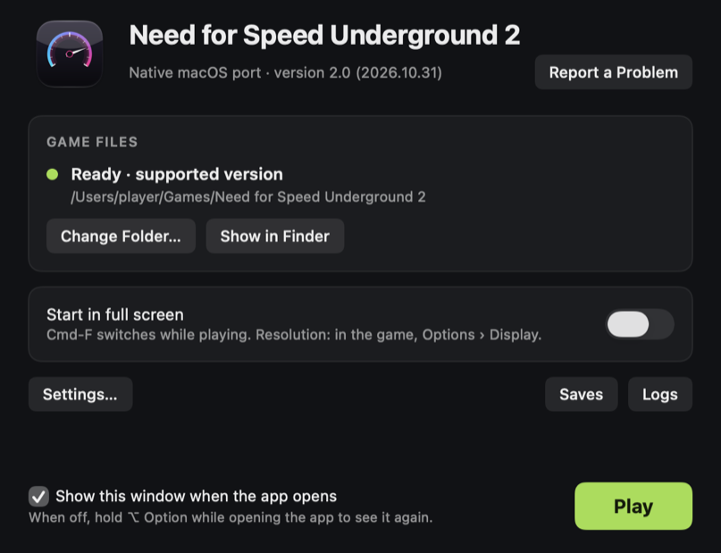

https://github.com/user-attachments/assets/f58f98bd-ca90-48fa-9a7d-5d056cf0cbbb

# Need for Speed: Underground 2 on Mac — native Apple Silicon port, no Wine

**Play *Need for Speed: Underground 2* (NFSU2, 2004) natively on Apple Silicon
Macs (M1 and later): no Wine, no CrossOver, no emulator, no virtual machine.**

NFSU2Recomp is a static recompiler and runtime that turn the original Windows PC
executable of the game (`SPEED2.EXE`, 32-bit x86, Direct3D 9) into a **native
ARM64 macOS app**. The game's x86 machine code is lifted to C ahead of time and
compiled with clang; Direct3D 9 is translated to Metal, DirectSound to
CoreAudio. There is no Wine, no emulator, no JIT and no Windows involved at run
time. On an M1 Pro, races run at **119 fps** (the display's limit), against
**10–15 fps** for the same game under Wine.

> **This repository contains no game code and no game assets.** It contains the
> recompiler and the runtime only. You need your own copy of the game. The C
> code generated from its executable is never committed. The prebuilt app on
> the [Releases page](https://github.com/TalhaMudo/NFSU2Recomp/releases/latest) contains the recompiled program but no game files:
> on first launch you point it at your own installation.


## Status

The game boots, reaches the menus, and races are playable with sound.

| Area | State |
|---|---|
| x86-32 → C lifter (integer, x87, MMX, SSE/SSE2, 3DNow!, string ops) | 23,278 functions, 137 MB of generated C |
| Win32 layer (CRT startup, heap, TLS, threads, files, registry, window) | working |
| Direct3D 9 → Metal, shader bytecode (vs/ps 1.x–2.x) → MSL | working |
| DirectSound → CoreAudio, DirectInput (keyboard, mouse, game controllers) | working |
| Videos (intro and story movies, decoded by the game itself) | working |
| Windowed, fullscreen, Retina-native and 1080p widescreen | working |
| Career mode: profile creation (name entry), save and load | working |
| Double-clickable `.app` with a launcher window (`./pack.sh`) | working |
| Optional "HD" build: MSAA (2× at 1440 lines and above, 4× below), SSR, ray-traced reflections | working, see `GRAPHICS_RESEARCH.md` |

### Known limitations

- **Two builds of `SPEED2.EXE` are supported**, the European and the North
  American v1.2 ones (see [Game versions](#game-versions)); each has its own
  engine. Other builds would need their own lifting pass and address map.
- Keyboard, mouse and game controllers (Xbox / PlayStation / MFi); no wheel
  support. No network play.
- Structured exception handling is not implemented (`RtlUnwind` /
  `RaiseException` are stubs).
- x87 is modelled with 64-bit doubles, not 80-bit extended precision.
- One workaround with an unknown root cause remains: the front end's
  world-view-projection matrix arrives broken and an identity matrix is injected
  instead (`FIXMAT`, see `run.sh`).
- About 310 instructions in rarely used opcodes (many of them data the
  disassembler mistook for code) are still emitted as traps. None are hit in the
  measured race scene.
- Some visuals are unverified against a Windows reference (crowds / skinned
  meshes). See "Remaining graphics items" in `PROJECT.md`.

## How it works

```
SPEED2.EXE (PE32, x86)
   │  tools/reloc2.py     recover the relocation table  → out/relocs.txt
   │  tools/genall.py     recursive-descent discovery + tools/lift.py
   ▼                      x86 → C, one C function per guest function
gen/all/shard_*.c  (128 files) + fntab.c (guest address → native function)
   │  build.sh            clang -O3, in parallel
   ▼
runtime/  (hand-written)  CPU state, guest memory, Win32, D3D9→Metal, audio
   │  link.sh
   ▼
out/nfsu2_boot            ~35 MB arm64 Mach-O
```

- **Pointers vs. constants.** The hard problem of x86 static recompilation is
  telling a 4-byte address from a 4-byte number. This executable has its
  relocation *directory entry* zeroed, but the relocation *data* is still
  physically present in an unnamed section. `tools/reloc2.py` parses it by hand:
  91,106 absolute addresses, all of which point into the image. Function
  discovery and jump-table recovery are seeded from it.
- **Guest memory.** The 32-bit guest address space is reserved with `mmap`;
  guest→host translation is a single ARM64 addressing mode
  (`ldr w8, [x_base, w_addr, uxtw]`).
- **Indirect calls** go through an O(1) table indexed by guest address.
- **Code generated at run time.** The game writes small x86 thunks to its stack
  and calls them. `runtime/genexec.c` detects these and runs them in a small
  interpreter, handing calls back to lifted functions.
- **D3DX effects.** The statically linked D3DX9 effect framework took ~47% of
  guest time when executed as lifted code; `runtime/d3dx_hle.c` short-circuits
  parts of it (`D3DX_HLE.md`).

| Path | What it is |
|---|---|
| `tools/lift.py` | x86-32 → C lifter, with lazy EFLAGS (flag liveness) |
| `tools/genall.py` | function discovery, parallel generation, sharding |
| `tools/reloc2.py` | relocation table recovery |
| `tools/argcount.py` | stdcall argument counts for imports |
| `tools/isatest.py`, `tools/fuzzisa.py` | instruction-semantics tests and differential fuzzer |
| `runtime/cpu.h`, `mem.c`, `dispatch.c`, `genexec.c` | CPU state, guest memory, dispatch, run-time code |
| `runtime/win32.c`, `win32_ext.c`, `fileio.c`, `res.c` | Win32 API layer |
| `runtime/com.c`, `metal.m`, `vsemu.c` | Direct3D 9 / DirectInput / DirectSound COM layer, Metal renderer, shader translation |
| `runtime/audio.m` | CoreAudio output |
| `runtime/overrides.c`, `d3dx_hle.c` | hand-written replacements for specific game functions |
| `runtime/enhance.c` | HD build only (`-DNFS_ENHANCED=1`) |
| `runtime/bundle.m`, `pack.sh` | `.app` behaviour and packaging |
| `launcher/*.swift` | the app's launcher window (Swift/SwiftUI): finds and checks the game, Original/HD, portable copy, data mods |
| `tests/boot.c` | program entry point (runs the game from its PE entry point) |

## Verification

- **Instruction semantics:** 169 hand-written tests, 439 checks
  (`tools/isatest.py` → `out/isatest`).
- **Differential fuzzing against real x86:** `tools/fuzzisa.py` assembles random
  instruction sequences, runs them as real x86-64 code under Rosetta 2 and as
  lifted C on ARM64, and compares registers, flags and memory.
- **Function-level tests:** 15 checks against lifted game functions
  (`out/nfsu2_all`).
- **Reproducible generation:** the generated C is a pure function of the
  executable and the tools; regenerating gives byte-identical output.

`./run.sh test` runs the first and third.

- **Integrity run:** `tools/check.sh` plays both builds invisibly and silently
  from the menus into a Quick Race (~1.5 min each) and checks the end-of-run
  report: no unsupported instructions, no unresolved indirect calls, no broken
  matrices, no GPU command buffer errors, no missing mip levels, the race was
  actually reached, and in the HD build that ray tracing and the separate
  G-buffer pass ran.  Settings are restored and saves go to a temporary folder.

## Performance

Measured on an M1 Pro at 1280×960, same scene and settings, alternating runs
(method, raw numbers and caveats in `WINE_COMPARISON.md`):

| | This port | Wine 11.18 (wined3d, Rosetta 2) |
|---|---|---|
| Race | 119 fps (capped by the 120 Hz display) | 10–15 fps |
| 3D menus | 119 fps | 45 fps |
| CPU time per frame | ~12.6 ms | ~105 ms |

Power while racing at the display's native resolution (3024×1964, 120 fps,
M1 Pro, `powermetrics`, a real play session): the standard build draws about
**6.5 W** for CPU + GPU, stays at or below 70 °C and never spins the fans; the
HD build draws about 18 W.

## Requirements

- Apple Silicon Mac, macOS 11 or later. Developed on an M1 Pro, macOS 27.
- Xcode Command Line Tools (`clang`; `swiftc` for the launcher window).
- Python 3 with `capstone` 5.x and `pefile` (`requirements.txt`).
- Rosetta 2, only for `tools/fuzzisa.py`.
- Your own installation of the game, with one of these executables (both v1.2
  without the CD check, built Feb 9 2005):

  | Build | `SPEED2.EXE` size | SHA-256 |
  |---|---|---|
  | **European** (PAL) v1.2 | 4,788,224 bytes | `8f6a9ae2c4cfa01181d2fd755d99c6f4b7103f60273908ea1de1e719dfe2a297` |
  | **North American** v1.2 | 4,800,512 bytes | `f9dd86c054878ce6276beb07c1fd61874f7a1e4bf1f241b084c65b73e24168a7` |

  The app checks the file at startup, picks the matching engine and says so
  instead of crashing on any other file; `NFSU2_ANY_EXE=1` skips the check.

### Game versions

The recompiled code belongs to one executable, so every build of `SPEED2.EXE`
gets its own lifting pass and engine. The game *data* is a separate matter (see
the note under the table).

| `SPEED2.EXE` | Size | SHA-256 | Status |
|---|---|---|---|
| European v1.2, no CD check | 4,788,224 | `8f6a9ae2c4cfa01181d2fd755d99c6f4b7103f60273908ea1de1e719dfe2a297` | **Supported** (the reference build) |
| North American v1.2, no CD check (the build most PC mods target) | 4,800,512 | `f9dd86c054878ce6276beb07c1fd61874f7a1e4bf1f241b084c65b73e24168a7` | **Supported** (engines `nfsu2-engine-na`, `-na-hd`). Tested on US disc data from the menus into a Quick Race, original and HD. |
| US v1.0 retail disc | 5,987,981 | `2cbd698fee8338a13d1891bc17d27e6641b4b9dd40580de818594b9140222899` | **Cannot be supported.** Protected by SafeDisc: the code section is encrypted on disc and only decrypted at run time, so there is nothing to recompile. |

The retail disc executable carries the disc's copy protection, and the official
v1.2 patch most likely keeps it (not verified here). A static recompiler needs
readable machine code, so the port cannot use a protected executable, and this
project does not remove copy protection.

**Data from the discs.** The US discs and the European release share 1,218 of
their ~1,250 files byte for byte. The differences are the region's cars (the US
release has `CARS/CIVIC` and `CARS/RSX`; the European one has `CARS/CORSA` and
`CARS/PEUGOT106`), the per-language movies, `FRONTEND/FrontB.lzc` and
`server.dll`.

**US data works with the supported executable.** The game's region is a
constant in the executable (`0` in the US build, `6` in the European one), and
it decides which of the region-only cars exist. Left at the European value, US
data hangs on the "Loading" screen as soon as a race picks a Corsa or a 106. The
runtime therefore looks at the data at startup: if `CARS/CIVIC` and `CARS/RSX`
are there but `CARS/CORSA` and `CARS/PEUGOT106` are not, it switches the game to
the US region (log line `region: North American data`). Tested on US disc data:
races load, the Civic is in the Quick Race car list and the Mazda is called
Miata, as in the US release; the region check hides the Corsa and 106.
`NFSU2_REGION=na` or `eu` forces either region.

### Installing from the PC discs on a Mac

The discs hold the game in plain zip files, so the Windows installer is not
needed. With the two disc images (`.cue`/`.bin`, `.iso`, or the disc folders):

```bash
brew install sevenzip     # only needed for .bin/.iso images
python3 tools/install_from_discs.py ~/Games/NFSU2 "Disc 1.cue" "Disc 2.cue"
```

This writes a normal game folder (about 1.7 GB) that the launcher can point at.
It copies the disc's `SPEED2.EXE` too, but see the table above: the disc
executable cannot run, so put a supported one in its place. The North American
v1.2 executable is the natural match for US disc data; the European one also
works with it (see "US data works with the supported executable" above).

### How the North American build is made

The European executable is the reference: the runtime was written against it.
`tools/addrmap.py` matches the two executables function by function (a byte
signature with the parts that move between builds masked, aligned in order) and
collects data-address pairs from the matched code: 23,276 of 23,277 functions
match, most code is 16 bytes away from the European build, most data is at the
same address. Every game address in the runtime is written as `GA(0x…)` in
European terms; for the North American engine `runtime/build_na.h` (generated
from the map) turns each one, and each `sub_XXXXXXXX` name the runtime uses, into
the North American one. An address the map cannot place stops the build.

Two things differ at run time:

- The North American no-CD executable still looks for a CD-ROM drive (its disc
  contents check is patched out, the drive check is not) and otherwise asks for
  "Disc 2" forever. Its engine reports `D:` as an empty CD-ROM drive; paths on
  `D:` resolve to the game folder like those on `C:`.
- Its region variable is in `.bss` (0, the US) rather than a constant, see
  "US data works with the supported executable".

Function discovery missed eight call targets in this executable (its linear scan
stops on bytes an earlier, misaligned scan covered), which became traps;
`LIFT_MISSING=1` (set by `tools/gen_v2.sh` for this build) lifts such targets in
extra shards.

## Build and run

Run everything from the repository root.

```bash
export NFSU2_DATA="/path/to/Need for Speed Underground 2"   # folder containing SPEED2.EXE
EXE="$NFSU2_DATA/SPEED2.EXE"

python3 -m venv .venv && .venv/bin/pip install -r requirements.txt

# 1) relocation table, cross-function flag liveness, lifting every function
#    to C, import argument table -> gen/all/   (~1 min on an M1 Pro)
#    The script holds the OVERRIDE list (functions that runtime/overrides.c and
#    runtime/d3dx_hle.c replace); it must match them or the link fails.
tools/gen_v2.sh "$EXE"

# 2) compile the shards, then build the runtime and link   (~1.5 min)
./build.sh && ./link.sh

./run.sh test        # ISA + function tests
./run.sh             # windowed
./run.sh 1080p       # 1920x1080, widescreen-corrected
./run.sh hd          # HD build
./pack.sh            # out/NFSU2.app: launcher + both engines (Original and HD)
./pack.sh --zip      # also out/NFSU2.zip for a release
./pack.sh --embed    # out/personal/NFSU2.app with your game inside (do not share)
```

For the North American v1.2 executable the same steps build a second pair of
engines; `tools/gen_v2.sh` recognises the file by its SHA-256 and writes `gen/na`,
`run.sh` picks the engine by the executable, and `pack.sh` adds the engines to the
app when they are built:

```bash
tools/gen_v2.sh "/path/to/NA/SPEED2.EXE"       # -> gen/na
BUILD=na ./build.sh && BUILD=na ./link.sh       # -> out/nfsu2_na_boot, out/nfsu2_na_hd_boot
```

`runtime/build_na.h` is committed. `link.sh` regenerates it from
`out/na/addrmap.json` when that file exists, which takes both executables:
`tools/addrmap.py build <European SPEED2.EXE> <North American SPEED2.EXE> out/na/addrmap.json`.
Do this after adding a `GA(...)` address or a `sub_` name to the runtime; game
addresses written without `GA(...)` would be wrong in the North American engine.

The app opens a small launcher window first (`launcher/`, built by `pack.sh`
with `swiftc`): it finds and checks `SPEED2.EXE`, offers Original or HD graphics
and full screen, opens the logs folder, manages saves (**Saves…**: the career
profiles, backups, ZIP export and import; the current saves are backed up before
an import replaces them; tests/save_manager.sh), and **Make Copy…** builds a
portable app with the game files inside (APFS clones, seconds on the same disk),
so nobody needs `pack.sh --embed` or a terminal for that. Untick "Show this
window when the app opens" to go straight into the game (hold Option to get the
window back). `NFSU2_SKIP_LAUNCHER=1` / `NFSU2_ENGINE=original|hd` do the same
from scripts. The Controller card turns the game controller on or off and sets its stick
dead zone (`NFSU2_PAD` / `NFSU2_PAD_DEADZONE`, which still win when set by hand).

The **Mods** card adds a few PC mods that change the game's own data files, each
with a switch (off by default, which is the original game): JeansBig's
[Detailed Map](https://nfsmods.xyz/mod/4485), XoLSt94's
[Upscaled Freeway Signs](https://nfsmods.xyz/mod/7342) and
[Carbon 4K](https://nfsmods.xyz/mod/7401).  The mods are not part of the app:
**Download** fetches the tested release from the mod's page on nfsmods.xyz and
checks its SHA-256, **Add File…** takes a copy you already have.  The launcher
applies them (`launcher/DataMods.swift`: replacement files, and the parts of
nlgxzef's Binary scripts these mods use) into
`~/Library/Application Support/NFSU2/Mods/Files`, which the engine reads before
the game folder (`NFSU2_MODS`); the game folder is never changed.



`run.sh` documents the environment switches; most are diagnostics.

While playing, **Cmd+Shift+D** writes the next frame as a PNG plus the full
draw list (to `~/Library/Logs/NFSU2/`), for reporting rendering problems.
`tools/session.sh [hd]` records a play session (frame times, CPU/GPU power,
temperature, fan speed, screenshots) and `tools/session_report.py` turns it into
a report.

## FAQ

**Can I play Need for Speed: Underground 2 on a Mac?**
Yes, on an Apple Silicon Mac (M1 or later) with your own copy of the PC game.
Download `NFSU2.zip` from the [Releases page](https://github.com/TalhaMudo/NFSU2Recomp/releases/latest), or build the port as
described above (`./pack.sh` produces a double-clickable `NFSU2.app`). Open it,
choose the game folder once, click Play. Menus, races, career saves and sound
work.

**Do I need Wine, CrossOver, Whisky, Parallels or a virtual machine?**
No. The game's code is recompiled to native ARM64 and runs directly on macOS.
Rosetta 2 is not used to run the game (only, optionally, by one test tool).

**Is it faster than Wine or CrossOver?**
On an M1 Pro at 1280×960: 119 fps in races (capped by the 120 Hz display)
against 10–15 fps under Wine 11.18 with Rosetta 2, and 119 fps against 45 fps
in the 3D menus. Method and raw numbers are in `WINE_COMPARISON.md`.

**Is there a ready-made download?**
Yes: the [Releases page](https://github.com/TalhaMudo/NFSU2Recomp/releases/latest) has `NFSU2.zip`. The app holds both
graphics modes, Original and HD (MSAA, ray-traced reflections), chosen in its
window; older releases had a separate `NFSU2.HD.zip`. It contains no game files:
the window asks for the folder that holds your own `SPEED2.EXE`.
The app is not notarized, so macOS blocks the first start: open System Settings ›
Privacy & Security and click **Open Anyway** (on macOS 14 and older: right-click
the app › Open). If macOS says the app is damaged, run once in Terminal:
`xattr -dr com.apple.quarantine /Applications/NFSU2.app`

**Can I carry the game to another Mac in one piece?**
Yes. In the app's window, **Make Copy…** creates "NFSU2 Portable.app" with the
game files inside: about 1.4 GB, plus the movies (1.1 GB) and the language packs in `LANGPACKS` if the game folder has them. Untick those when saving it for a smaller copy. It runs on its own; saves stay in
`~/Library/Application Support/NFSU2 Saves` on each Mac. It contains the game,
so keep it for yourself.

**Which version of the game does it need?**
The Windows PC version, with the European or the North American v1.2
`SPEED2.EXE` listed under [Requirements](#requirements). The US v1.0 disc
executable cannot be supported (it is copy-protected). Console versions are not
supported. See [Game versions](#game-versions).

**I only have the PC discs. Can I install them on a Mac?**
Yes, without Windows: `tools/install_from_discs.py` unpacks the disc images
into a game folder. See [Installing from the PC discs on a
Mac](#installing-from-the-pc-discs-on-a-mac).

**Does it work on Intel Macs?**
No. Only Apple Silicon is targeted and tested.

**What does not work yet?**
There is no wheel support and no online play.
See [Known limitations](#known-limitations).

**How is this different from other NFSU2 projects?**

| Project | Approach | Platforms |
|---|---|---|
| **NFSU2Recomp** (this) | Recompiles the PC executable with its own x86 → C lifter; own Direct3D 9 → Metal renderer | macOS (Apple Silicon) |
| [OpenUG2](https://github.com/whoismept/OpenUG2) | Reimplements the engine from scratch and reads the game's data files; does not run the original code | Linux, macOS, Windows |
| [nfsu2-recompiled](https://github.com/codepdbh/nfsu2-recompiled) | Recompiles the PC executable with pcrecomp; Direct3D 9 through DXVK | Windows, Android |
| [nfsu2-sw](https://github.com/antoxa2584x/nfsu2-sw) | Recompiles the original Xbox version with xboxrecomp | Nintendo Switch, Linux |

## Related work

Static recompilation of x86 is not new, and this is not the first project to do
it:

- [M-HT/SR](https://github.com/M-HT/SR) statically recompiles DOS and Windows
  game executables (Septerra Core, Battle Isle 3 and others) at assembly level,
  for targets including macOS arm64.
- [sp00nznet/xboxrecomp](https://github.com/sp00nznet/xboxrecomp) lifts original
  Xbox (x86) games to C with a Python + Capstone pipeline very similar to this
  one.
- [N64: Recompiled](https://github.com/N64Recomp/N64Recomp) and
  [XenonRecomp](https://github.com/hedge-dev/XenonRecomp) established the
  approach for MIPS and PowerPC consoles, and are where the method here comes
  from.
- McSema, rev.ng, RetDec and BinRec are IR-based binary lifters from the research
  side.

What this project adds is narrower: recovering a relocation table whose
directory entry was zeroed and using it to separate pointers from constants; a
differential instruction fuzzer that uses Rosetta 2 as the oracle; a hybrid
interpreter for x86 code the game generates at run time; and an end-to-end,
playable Win32 + Direct3D 9 → macOS ARM64 + Metal port of a 23,000-function 3D
game.

## Documentation

- `PROJECT.md` — chronological engineering log: findings, bugs and root causes,
  measurements.
- `D3DX_HLE.md` — high-level emulation of the D3DX effect framework.
- `GRAPHICS_RESEARCH.md` — graphics research and the HD build.
- `LIFTER_EFFICIENCY.md` — lifter efficiency work and measurements.
- `WINE_COMPARISON.md` — comparison against Wine.
- `LITERATURE.md` — related work.
- `screenshots/report/nfsu2-report.html` — illustrated project report.

## How this was built

Development was carried out with an AI coding assistant (Claude Code) under the
direction of the project owner. Goals, constraints and priorities, observations
from playing the game, Windows reference material and direction decisions came
from the project owner; implementation, measurement and debugging were done
together with the assistant.

## Legal

Copyright (c) 2026 Talha Müderrisoğlu. All rights reserved.

This repository is **not open source**. You may download, build, run and
modify it for your own personal, non-commercial use with your own copy of the
game. Publishing, distributing or sharing it — or any modified version, port,
fork or build of it — and any commercial use require prior written
permission. See `LICENSE`.

**Permission:** to publish, share or build on this code, ask first by opening
an issue in this repository.

This project is not affiliated with or endorsed by Electronic Arts. *Need for
Speed* and *Need for Speed: Underground 2* are trademarks of Electronic Arts
Inc. The repository contains none of the game's code or data. Screenshots show
the game running through this port and are included for documentation; the
game content in them belongs to its owners.
